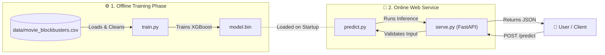

# Movie Blockbuster Hit Prediction Service

A machine learning classification project that predicts whether a film will become a commercial **blockbuster** based on pre-release features such as budget, genre, runtime, and release period.

This project was built as part of the **Machine Learning Zoomcamp (2026 Cohort)**.

---

## 📌 Problem Description

Film production studios and distributors face immense financial risks when greenlighting new projects. Marketing budgets and resource allocations heavily depend on estimating a movie's commercial potential early in production.

This project addresses this challenge by providing a **Machine Learning Web Service API** that calculates the probability of a film becoming a blockbuster based on information available _prior_ to its release.

### Target Definition

Using a dataset of 5,000 films (spanning 1980–2024), the binary target variable `blockbuster` is defined as:

- **`1` (Blockbuster)**: If Box Office Revenue exceeds **3× Production Budget** AND Revenue is greater than **$100 Million**.
- **`0` (Non-Blockbuster)**: Otherwise.

The dataset has a realistic class imbalance (~13% blockbuster hit rate).

---

## 📊 Dataset & Features

- **Source**: `movie_blockbusters.csv` (Synthetic benchmark dataset with 5,000 films).
- **Pre-Release Features Used ($X$)**:
  - `genre` (Categorical: Primary genre e.g., Action, Comedy, Sci-Fi)
  - `budget_usd` (Numerical: Production budget in USD)
  - `runtime_min` (Numerical: Runtime in minutes)
  - `year` / `decade` (Numerical/Categorical: Release timing)
- **Target ($y$)**: `blockbuster` (Binary: 0 or 1)

**Credits** This dataset was taken from Kaggle - [What Makes a Movie a Blockbuster? 5,000 Films](https://www.kaggle.com/datasets/vedauv/what-makes-a-movie-a-blockbuster-5000-films)

> ⚠️ **Data Leakage Prevention**: Features calculated _after_ release (such as `revenue_usd`, `profit_usd`, `roi`, `rating`, `vote_count` and `popularity`) are strictly dropped during model training to ensure realistic prediction.

---

## 🔍 Exploratory Data Analysis & Feature Engineering

Key insights from EDA:

- **Budget Skewness**: `budget_usd` spans several orders of magnitude; log transformation (`log_budget`) was applied to normalize feature distribution.
- **Feature Engineering**:
  - `log_budget`: **_log(1 + budget_usd)_**
  - `budget_per_min`: Financial intensity measure calculated as **_budget_usd/runtime_min_**.

Preprocessing Pipeline:

- Categorical encoding via `DictVectorizer`.
- Feature scaling via `StandardScaler` for distance/linear models.
- Stratified 60% / 20% / 20% split for train, validation, and test datasets.

---

## 🏆 Model Training & Comparison

Models were evaluated using **ROC-AUC** due to class imbalance:

| Model                   | Hyperparameters / Notes                                                                              | Validation ROC-AUC |
| :---------------------- | :--------------------------------------------------------------------------------------------------- | :----------------- |
| **Logistic Regression** | `class_weight='balanced'`, scaled features                                                           | ~0.841             |
| **Decision Tree**       | Tuned `max_depth` (5) & `min_samples_leaf` (1)                                                       | ~0.805             |
| **Random Forest**       | Tuned `n_estimators` (106), `max_depth` (5), `min_samples_leaf` (1), `class_weight='balanced'`       | ~0.840             |
| **XGboost**             | Tuned `eta` (0.1), `max_depth` (3), `min_child_weight` (1), `gamma` (7.0), `class_weight='balanced'` | **~0.848**         |

**Final Holdout Test ROC-AUC:** `0.8411` (trained on `train + val`, evaluated once on `test`).

---

## 🛠️ Project Structure

```bash
movie-blockbuster-prediction/
├── data/
│   └── movie_blockbusters.csv      # Dataset
├── src/
│   └── movie_blockbuster_prediction/
├── Dockerfile                      # Containerization instructions
├── notebook.ipynb                  # Complete EDA, feature engineering & model comparison
├── predict.py                      # Core inference logic module (loads model.bin)
├── pyproject.toml                  # Project configuration & dependency specifications
├── README.md                       # Project documentation
├── serve.py                        # FastAPI web application service
├── train.py                        # Script to train final model & save artifacts (model.bin)
└── uv.lock                         # Lockfile for 100% reproducible environments
```

---

## 📐 System Architecture



---

## ⚙️ Environment Setup & Local Execution

This project uses [uv](https://github.com/astral-sh/uv) — an extremely fast Python package manager — for dependency management and environment isolation.

### 1. Prerequisites

- Python 3.11+
- `uv` package manager installed on your system.

```bash
# Install uv (macOS/Linux)
curl -LsSf https://astral.sh/uv/install.sh | sh

# Install uv (Windows PowerShell)
powershell -ExecutionPolicy ByPass -c "irm https://astral.sh/uv/install.ps1 | iex"
```

### 2. Installation & Environment Synchronization

Clone the repository and install the exact pinned dependencies into a local virtual environment:

```bash
git clone https://github.com/dilawarzAlgorithm/movie-blockbuster-prediction.git
cd movie-blockbuster-prediction

# Sync virtual environment directly from uv.lock
uv sync
```

### 3. Training the Model

To train the final model and export the model binary artifacts, run:

```bash
uv run python train.py
```

### 4. Running the Web Service Locally

Start the prediction web service server:

```bash
uv run python serve.py
```

The server will start running on `http://localhost:9696`.

### 5. API Testing & Examples

**Health Check Endpoint (`GET /health`)**

```bash
curl -X GET http://localhost:9696/health
```

Response:

```bash
{"status": "OK"}
```

**Prediction Endpoint (`POST /predict`)**

```bash
curl -X POST http://localhost:9696/predict \
  -H "Content-Type: application/json" \
  -d '{
    "year": 1997,
    "decade": 1990,
    "genre": "Action",
    "runtime_min": 138,
    "budget_usd": 140242806.18
  }'
```

Expected JSON Response:

```bash
{
  "blockbuster_probability": 0.7839,
  "is_blockbuster": true
}
```

> Interactive Documentation: Interactive OpenAPI Swagger documentation can also be accessed by visiting http://localhost:9696/docs in your browser.

### 6. Running JupyterLab

To launch and run `notebook.ipynb` within JupyterLab using the `uv` virtual environment:

```bash
uv run jupyter lab
```

---

## 🐳 Docker Containerization

To run the web service in an isolated production container using Docker:

1. **Build the Docker Image**

```bash
docker build -t blockbuster-prediction-service .
```

2. **Run the Docker Container**

```bash
docker run -it --rm -p 9696:9696 blockbuster-prediction-service
```

Test the containerized endpoint in a separate terminal:

```bash
curl -X GET http://localhost:9696/health
```

---
